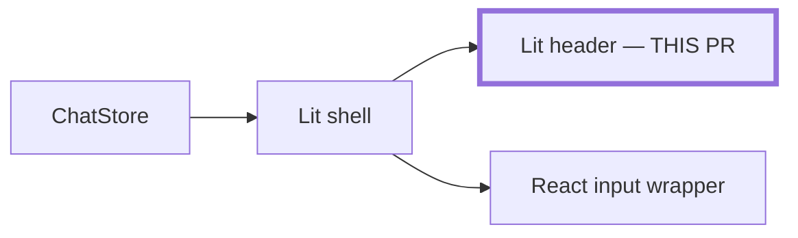
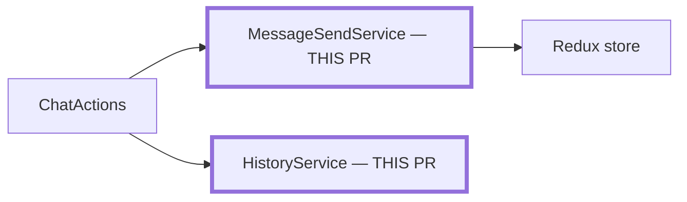

# diagrams.md — architecture diagrams in a PR description

Load this when the PR is stacked, or moves data or event flow, or ownership of state or behavior, between modules. Crossing packages and CSS-only changes don't count. Without a trigger, leave out `#### Architecture` and skip this file.

## Pick the diagrams

| PR | Draw |
| --- | --- |
| Stacked | As is, then To be |
| Last PR in a stack or theme | To be only |
| Not stacked, changes flow or ownership | One diagram of the system after the change |

## Use one format

- **Draw a Mermaid `flowchart`** in a `mermaid` fence under `#### Architecture`. Put a bold **As is** or **To be** lead-in above each stacked diagram.
- **Mark the nodes this PR changes** with a thick border and a `THIS PR` label, so the cue doesn't rely on color. Use `classDef thisPR stroke-width:4px`.
- **Leave every other node plain.** Use no other classes, colors, or labels.
- **Write a 1–3 line explainer** under each diagram. Leave out commit hashes and check results.

## Stacked PRs

**As is** shows the system at this PR's head. Scope it to the part of the stack this PR edits. Its explainer says what this PR moved and what's still on the old path.

**To be** comes from the stack's plan, which keeps one To be diagram in this format:

1. Copy the plan's diagram.
2. Strip any existing labels and color classes, such as `INHERITED` or `LATER`.
3. Mark this PR's nodes as above.

If the plan has no diagram, draw the stack's end state in this format. Its explainer says what the rest of the stack still has to do. For the last PR, say what this PR finishes.

An As is example:

This PR moves the header into the Lit shell. The input still renders through the React wrapper until the next PR.

## Non-stacked PRs

Draw one diagram of the system after the change. Mark the changed nodes as above. The explainer says what moved and which module now owns it.

An example:

Message sending and history loading move out of ChatActions into their own services. ChatActions now only delegates.

## Related guidance

- [caic-pr](../SKILL.md) — read when drafting the rest of the description
- [plan-files.md](../../caic-plan/references/plan-files.md) — read when the stack's plan needs its To be diagram
