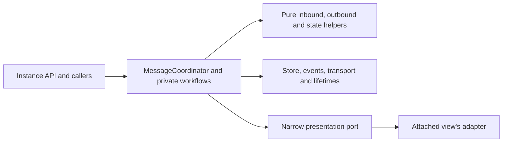

# Messaging ownership

Route assistant effects through `MessageCoordinator` (C) and its private workflows. Keep data work separate from effects.

- C owns assistant message writes, lifecycle changes, event delivery and transport effects. Keep queue execution, promises, controllers and effect closures in C-owned workflows.
- Keep `inbound/`, `outbound/` and `state/` data-only. Pass values and opaque tokens, not managers, stores or callbacks. Allocate IDs and read clocks in core callers. Preserve each queue and lifetime domain.
- Use the view port only for view work. C looks it up at the start of each call through the attached view's bindings; never store it on an object that outlives the call. With no view attached, keep the same callback waits, public results and chat state. Reasoning items share one session per visible item: the mounted view fires them while attached, and the committed-state observer fires them while not, so a switch neither repeats nor drops one. Both use the shared event queue.
- Keep human-agent writes and sends in their own path. Route shared UI metadata through `messageMetadataCommands`; its private store provenance selects C or the existing human-agent action. Do not trust speaker fields supplied by the caller.
- Keep public types, event order, aliases and waits unchanged. Native snapshots freeze plain records and arrays. Special copies can stay mutable; opaque references and function state can remain shared. See [the snapshot contract when changing payload copies](../../../../docs/UpsertMessage.md).

Read these proofs when changing their boundary:

- [Runtime imports, type capabilities and allowed writers](../../../../tests/services/spec/messagingBoundary_spec.ts), with [the guard implementation when extending a check](../../../../tests/services/helpers/messagingBoundary.ts).
- [Public routes without a view adapter](../../../../tests/instance/spec/messaging/headlessPublicRoutes_spec.ts).
- [Shared metadata writes](../../../../tests/services/spec/messageMetadataCommands_spec.ts).

Add a failing test before you allow a new boundary call. Tie each exception to exact calls and their owners.

## Related guidance

- [When wiring or testing a service](../../../../references/services.md).
- [When changing store actions or state](../../store/AGENTS.md).
- [When working elsewhere in this package](../../../../AGENTS.md).
